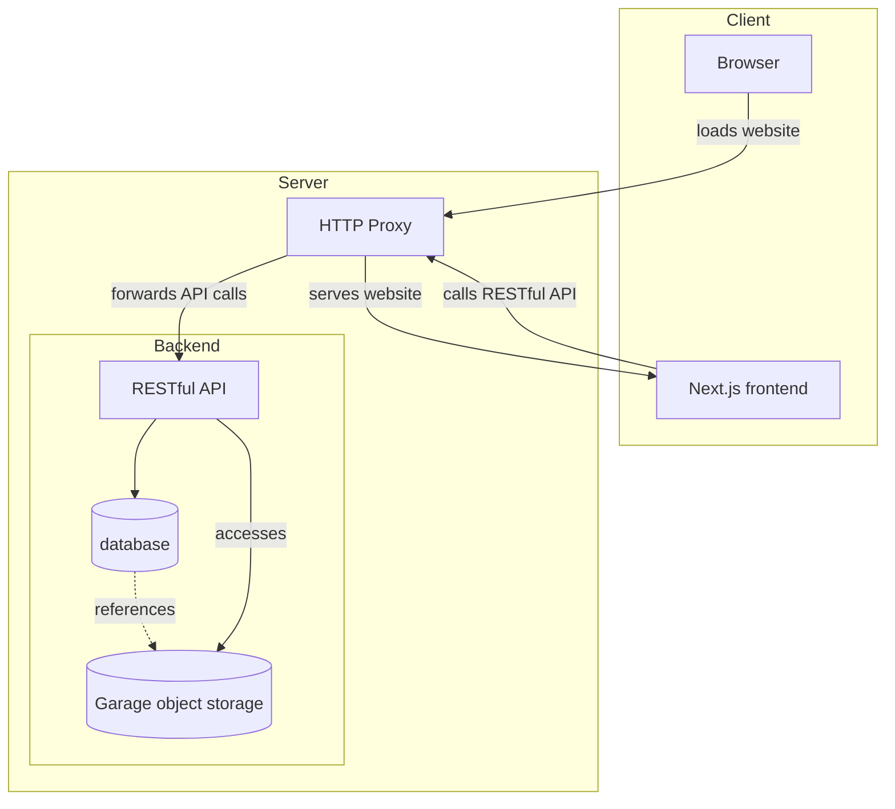

# web

[](https://github.com/fachschaftinformatik/web/releases/latest)
[](https://github.com/fachschaftinformatik/web/blob/main/go.mod)
[](https://github.com/fachschaftinformatik/web/actions/workflows/ci.yaml)

Website of the student representative body for computer science at Westphalian University.

If you believe you have found a security issue, please contact us at security@fsv-wh.de.

## Documentation

For the API spec please refer to [/docs](/docs). The live API documentation can be found [here](https://ik.fsv-wh.de/swagger/index.html).

### Architecture



The `database` holds all relevant meta data and references to the blobs. All blobs are stored in the S3 compatible `object storage`. For a more detailed overview have a look at the [initial SQL schema](https://github.com/fachschaftinformatik/web/blob/main/database/migrations/0001_initial_schema.sql).

## Getting started

The application image bundles the Go API and Next.js frontend in one Alpine
container. Docker Compose starts the application and Garage:

```sh
docker compose up --build
```

Open `http://localhost:3000`. Next.js proxies `/api/v1` and `/swagger` to the API
inside the container. SQLite data persists at `/data`. Compose also exposes the
API on `127.0.0.1:8080` for local development.

To develop the frontend with hot reload while Compose is running, use a separate
development port:
```sh
cd website
bun install
bun run dev --port 3001
```

Configure the frontend in `website/.env.local`:

```dotenv
BACKEND_URL=http://localhost:8080
AUTH_URL=http://localhost:3001
AUTH_SECRET=replace-with-a-random-secret
INTERNAL_JWT_SECRET=replace-with-a-shared-random-secret
```

Set `AUTH_SECRET` and the same `INTERNAL_JWT_SECRET` in the repository-root `.env`
file for Compose.
Generate secrets with `openssl rand -hex 32`.

### Object storage

Garage v2.4.1 provides S3-compatible object storage. Compose initializes a single-node instance,
an application key, and the `development` bucket automatically. Data and metadata persist in
the `garage` volume; the SQLite application database persists separately in `database`.
The storage API is only exposed on the internal Compose network.

`garage.toml` and the default Compose credentials are for local development. For production,
generate a unique RPC secret, create a dedicated application key with read/write access to its
bucket, and configure the API with that key. Garage's S3 region is `us-east-1`.
The Go storage adapter uses the S3-compatible `minio-go` client library; no MinIO server is required.

Inspect local storage with:

```sh
docker compose exec garage /garage status
docker compose exec garage /garage bucket info development
```

For more information on how to build the project, read [CONTRIBUTING.md](https://github.com/fachschaftinformatik/web/blob/main/.github/CONTRIBUTING.md#building).

The following environment variables are being used and should be set accordingly:

| Variable | Local Compose value | Notes |
| --- | --- | --- |
| `DOMAIN` | `http://localhost:3000` | The domain the frontend will be reachable at. Used for CORS, redirects and URL generation. |
| `SIGNUPS_ENABLED` | `true` | Whether new signups are allowed. |
| `SIGNUPS_VERIFY` | `true` | Whether signups must verify their email address. Requires SMTP configuration. |
| `AUTH_URL` | `http://localhost:3000` | Public URL used by the application's authentication flow. |
| `AUTH_SECRET` | Development-only default | Authentication session secret; override outside local development. |
| `INTERNAL_JWT_SECRET` | Development-only default | Secret used by the frontend to authenticate API requests. |
| `S3_ENDPOINT` | `garage:3900` | S3 service host and port, without a URL scheme. |
| `S3_BUCKET` | `development` | Name of the bucket. |
| `S3_USE_SSL` | `false` | Whether to use TLS for the S3 connection. |
| `S3_ACCESS_KEY` | `GK0123456789abcdef01234567` | Development key; override via Compose environment variables. |
| `S3_SECRET_KEY` | `0123456789abcdef` repeated four times | Development secret; override via Compose environment variables. |
| `SMTP_HOST` |  | SMTP host. |
| `SMTP_PORT` |  | SMTP port. |
| `SMTP_USERNAME` |  | SMTP username. |
| `SMTP_PASSWORD` |  | SMTP password. |
| `SMTP_FROM` |  | SMTP address used for sending emails. |

## Contributing

If you wish to contribute to the this project, thank you!
Please refer to [CONTRIBUTING.md][1] for guidance.

## Legal

SPDX-License-Identifier: MPL-2.0

[1]: https://github.com/fachschaftinformatik/web/tree/main?tab=contributing-ov-file
